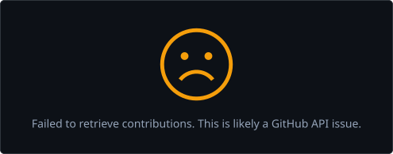

<!-- Animated Header Title with Typewriter SVG -->

  <strong>Senior Software Engineering Student @ Adama Science and Technology University (ASTU)</strong> 
  <em>Engineering dependable, production-grade full-stack web platforms, REST APIs, and native mobile applications.</em>

<!-- Live Telemetry, Visitor Counter & Profile Status Badges -->

  
  
  
  

<!-- Quick Social Links Bar -->

  
  
  
  

---

## ⚡ About Me

I am a senior **Software Engineering student** at **Adama Science and Technology University (ASTU)** in Ethiopia. I build robust digital platforms and mobile applications designed to solve real-world community, educational, and business challenges.

- 🎓 **Academic Excellence:** Final-year student focusing on software architecture, distributed systems, relational databases, data structures, and algorithms.
- 🌍 **Purpose-Driven Engineering:** Creating practical digital ecosystems like **CodeTogether** (real-time pair programming), **TemariHub** (STEM career enablement), **Lehulu** (local services marketplace), and **Student Registration System** (Java EE enterprise portal).
- 💻 **Modern Full-Stack Web:** End-to-end web engineering with **React 19**, **TypeScript (Strict)**, **Tailwind CSS**, **Node.js**, and **Express.js**.
- 📱 **Cross-Platform Mobile:** Native mobile applications built with **Flutter 3** and **Dart**, structured around Clean Architecture and reactive state management.
- 💾 **Database & Enterprise Systems:** Relational schema design with **MySQL & JDBC** alongside document persistence (**MongoDB Atlas**) and secure RESTful API integrations.
- 🧪 **High Engineering Standards:** Passionate about test-driven confidence, security best practices (JWT auth, CSRF protection), clean modular architecture, and structured Git workflows.

---

## 🛠️ Core Technical Arsenal

### 💻 Programming Languages

### 🎨 Frontend & UI Frameworks

### ⚙️ Backend, APIs & Architecture

### 📱 Mobile Ecosystem

### 🗄️ Databases & Persistence

### 🛠️ Developer Tools & Cloud Platforms

---

## 🌟 Flagship Engineering Projects

<table>
  <tr>
    <td width="50%" valign="top">
      <h3>💻 CodeTogether — Real-Time Collaborative Code Editor</h3>
      
<em>Full-featured collaborative workspace engineered for remote pair programming with live concurrent code editing and integrated WebRTC communication.</em>

      <ul>
        <li><strong>Architecture:</strong> JavaScript, React, Node.js, Express, Socket.IO, WebRTC</li>
        <li><strong>Live Sync:</strong> Sub-millisecond code broadcast, multi-cursor awareness, and shared execution state</li>
        <li><strong>Voice & Video:</strong> Integrated peer-to-peer WebRTC calls directly within the code editor</li>
      </ul>
      

        <a href="https://github.com/petersisay/CodeTogether"><b>💻 GitHub Repository</b></a>
      

    </td>
    <td width="50%" valign="top">
      <h3>🎓 TemariHub — STEM Opportunity Platform</h3>
      
<em>Full-stack opportunity discovery and application tracking platform crafted for Ethiopian university STEM students.</em>

      <ul>
        <li><strong>Architecture:</strong> TypeScript, React 19, Node.js, Express, MongoDB Atlas</li>
        <li><strong>Application Pipeline:</strong> Multi-stage kanban tracking, deadline telemetry, and dynamic Amharic & English UI</li>
        <li><strong>Quality:</strong> Automated integration testing, CSRF protection, and admin moderation</li>
      </ul>
      

        <a href="https://temari-hub.vercel.app" target="_blank"><b>🌐 Live Platform</b></a> • 
        <a href="https://github.com/petersisay/TemariHub"><b>💻 GitHub Repository</b></a>
      

    </td>
  </tr>
  <tr>
    <td width="50%" valign="top">
      <h3>🛠️ Lehulu — Ethiopian Services Marketplace</h3>
      
<em>Production-grade marketplace connecting households and businesses with verified service professionals across Adama, Bishoftu, and Addis Ababa.</em>

      <ul>
        <li><strong>Architecture:</strong> TypeScript, React, Tailwind CSS, Express REST API, MongoDB Atlas</li>
        <li><strong>Geospatial Boundaries:</strong> Location-based provider discovery with MongoDB <code>2dsphere</code> indexing</li>
        <li><strong>Governance:</strong> Dedicated portals for Customers, Service Providers, and Verification Admins</li>
      </ul>
      

        <a href="https://lehulu-two.vercel.app" target="_blank"><b>🌐 Live Platform</b></a> • 
        <a href="https://github.com/petersisay/lehulu"><b>💻 GitHub Repository</b></a>
      

    </td>
    <td width="50%" valign="top">
      <h3>🏛️ Student Registration System — Java EE Enterprise App</h3>
      
<em>Academic management web platform engineered with Java EE and MVC architecture to streamline course registration, student enrollment, and grading.</em>

      <ul>
        <li><strong>Architecture:</strong> Java, Java Servlets, JSP, JSTL, MySQL, Apache Tomcat</li>
        <li><strong>Lifecycle:</strong> Course catalog management, credit threshold validation, and student grade tracking</li>
        <li><strong>Persistence:</strong> Normalized relational MySQL schema with JDBC connection pooling and transactions</li>
      </ul>
      

        <a href="https://github.com/petersisay/StudentRegisterSystem"><b>💻 GitHub Repository</b></a>
      

    </td>
  </tr>
  <tr>
    <td width="50%" valign="top">
      <h3>🛒 AdamaMaterials — E-commerce Web Platform</h3>
      
<em>Modern e-commerce platform built with TypeScript, delivering responsive product discovery, cart state management, and full-stack ordering workflows.</em>

      <ul>
        <li><strong>Architecture:</strong> TypeScript, React, Node.js, Express, Tailwind CSS</li>
        <li><strong>Catalog & Cart:</strong> Dynamic product categorization, inventory display, and structured state persistence</li>
        <li><strong>Design:</strong> Responsive, high-performance UI styled with Tailwind CSS for mobile and desktop</li>
      </ul>
      

        <a href="https://github.com/petersisay/AdamaMaterials-E-commerce-"><b>💻 GitHub Repository</b></a>
      

    </td>
    <td width="50%" valign="top">
      <h3>📱 Mobile Engineering — Revola & Flutter Todo Pro</h3>
      
<em>Cross-platform mobile applications engineered in Flutter and Dart, built with Clean Architecture principles and reactive state handling.</em>

      <ul>
        <li><strong>Architecture:</strong> Flutter 3, Dart, Clean Architecture, Provider / Riverpod</li>
        <li><strong>Features:</strong> Real-time task workflows, persistent local state, and smooth 60fps animations</li>
        <li><strong>UI/UX:</strong> Adaptive Material 3 design crafted for modern Android and iOS experiences</li>
      </ul>
      

        <a href="https://github.com/petersisay/App-revola"><b>💻 App-revola Repo</b></a> • 
        <a href="https://github.com/petersisay/flutter_todo_pro"><b>💻 Flutter Todo Repo</b></a>
      

    </td>
  </tr>
</table>

---

## 📊 GitHub Analytics & Activity

<!-- Side by Side Stats Cards with High-Contrast Dark Theme -->
<table border="0" style="border: none;">
  <tr style="border: none;">
    <td style="border: none;" align="center">
      
    </td>
    <td style="border: none;" align="center">
      
    </td>
  </tr>
</table>

<!-- GitHub Streak Stats with Explicit High-Contrast Colors (Vivid White & Cyan) -->

  

---

## 🎯 Engineering Mindset & Goals

- 💡 **Philosophy:** *"Doing small things before taking major steps compounds over time to create a huge impact."*
- 🔭 **Current Focus:** Scaling Ethiopian civic & commercial platforms (**TemariHub** and **Lehulu**), refining distributed backend architectures, and reactive cross-platform mobile patterns.
- 🎯 **Career Target:** Seeking **Software Engineering Internships** and **Junior Full-Stack Developer** roles where I can build impactful products and collaborate with world-class engineering teams.
- 💬 **Let's Talk About:** TypeScript architecture, Node.js API optimization, Flutter patterns, relational schema design, and modern web frameworks.

---

## 📬 Let's Connect & Collaborate

Whether you have an opportunity, an open-source collaboration idea, or just want to chat about tech, feel free to reach out!

| Platform | Details | Quick Action |
|:---|:---|:---:|
| 🌐 **Personal Website** | `petros-portfolio-one.vercel.app` | [**Explore Portfolio**](https://petros-portfolio-one.vercel.app) |
| 💼 **LinkedIn** | `Petros Sisay` | [**Connect on LinkedIn**](https://www.linkedin.com/in/petros-sisay-gelan/) |
| 📧 **Direct Email** | `petrossisay1646@gmail.com` | [**Send Email**](mailto:petrossisay1646@gmail.com) |
| 💬 **Telegram** | `@Petros_sisay` | [**Direct Message**](https://t.me/Petros_sisay) |
| 🐙 **GitHub** | `@petersisay` | [**Follow Profile**](https://github.com/petersisay) |

 

  

