<!-- Animated Header Title with Typewriter SVG -->

  <strong>Senior Software Engineering Student @ Adama Science and Technology University (ASTU)</strong> 
  <em>Specializing in Full-Stack MERN Web Applications, Native Flutter/Dart Mobile Platforms & Scalable REST APIs.</em>

<!-- Live Telemetry, Visitor Counter & Profile Status Badges -->

  
  
  
  

<!-- Quick Social Links Bar -->

  
  
  
  

---

## ⚡ About Me

I am a final-year **Software Engineering student** at **Adama Science and Technology University (ASTU)** in Ethiopia. I architect dependable full-stack web platforms and reactive mobile applications engineered to solve community, commercial, and educational challenges.

- 🎓 **Academic Excellence:** Final-year student focusing on software architecture, distributed systems, relational & NoSQL databases, data structures, and algorithms.
- 🌐 **Full-Stack MERN Architecture:** Specializing in end-to-end web platforms using **MongoDB**, **Express.js**, **React 19**, and **Node.js**, reinforced with **TypeScript**, Tailwind CSS, secure JWT authentication, and RESTful APIs.
- 📱 **Cross-Platform Mobile:** Crafting high-performance native mobile experiences with **Flutter 3** and **Dart**, structured around **Clean Architecture**, reactive state management (**Riverpod / Provider**), and offline-first persistence.
- 🌍 **Shipped Commercial & Civic Platforms:** Shipped production-ready applications including **Tekami** (reclaimed materials marketplace), **Lehulu** (local on-demand services), **TemariHub** (STEM career opportunities), and **CodeTogether** (real-time pair programming).
- 💾 **Data Engineering & Persistence:** Designing schema architectures with **MongoDB Atlas** alongside relational databases (**MySQL**) with ACID transactions and connection pooling.
- 🧪 **Engineering Rigor:** Dedicated to clean code, comprehensive testing, secure auth flows, and automated CI/CD GitHub workflows.

---

## 🛠️ Core Technical Arsenal

### 🌐 Full-Stack MERN & Web Architecture

### 📱 Cross-Platform Mobile Engineering

### ⚙️ Backend, APIs & Distributed Systems

### 🗄️ Databases & Persistence

### 🛠️ Developer Tooling, CI/CD & Cloud

---

## 🌟 Flagship Engineering Projects

<table>
  <tr>
    <td width="50%" valign="top">
      <h3>♻️ Tekami — Managed Reclaimed Materials Marketplace</h3>
      
<em>Production-grade digital marketplace connecting construction, recycling, and enterprise vendors to trade reclaimed and surplus industrial materials across Ethiopia.</em>

      <ul>
        <li><strong>Architecture:</strong> JavaScript, React, Node.js, Express, MongoDB Atlas, Tailwind CSS</li>
        <li><strong>Payment Integration:</strong> Secure checkout pipeline integrated with the Chapa payment gateway</li>
        <li><strong>Verification:</strong> Strict multi-role authentication, order telemetry, and material certification tracking</li>
      </ul>
      

        <a href="https://tekami.vercel.app" target="_blank"><b>🌐 Live Platform</b></a> • 
        <a href="https://github.com/petersisay/tekami"><b>💻 GitHub Repository</b></a>
      

    </td>
    <td width="50%" valign="top">
      <h3>🛠️ Lehulu — Ethiopian Services Marketplace</h3>
      
<em>Comprehensive on-demand marketplace connecting households and businesses with verified trade and service specialists across Adama, Bishoftu, and Addis Ababa.</em>

      <ul>
        <li><strong>Architecture:</strong> Pure JavaScript MERN Stack, React, Node.js, Express, MongoDB Atlas</li>
        <li><strong>Geospatial Intelligence:</strong> Distance-based service matching powered by MongoDB <code>2dsphere</code> spatial indexing</li>
        <li><strong>Portals:</strong> Dedicated operational dashboards for Customers, Service Providers, and Verification Admins</li>
      </ul>
      

        <a href="https://lehulu-two.vercel.app" target="_blank"><b>🌐 Live Platform</b></a> • 
        <a href="https://github.com/petersisay/lehulu"><b>💻 GitHub Repository</b></a>
      

    </td>
  </tr>
  <tr>
    <td width="50%" valign="top">
      <h3>💻 CodeTogether — Real-Time Collaborative Code Editor</h3>
      
<em>Full-featured collaborative developer workspace engineered for remote pair programming with live concurrent code editing and integrated WebRTC communication.</em>

      <ul>
        <li><strong>Architecture:</strong> React, Node.js, Express, Socket.IO, WebRTC</li>
        <li><strong>Live Sync:</strong> Sub-millisecond code broadcast, multi-cursor awareness, and shared execution state</li>
        <li><strong>Voice & Video:</strong> Integrated peer-to-peer WebRTC calls directly within the code editor</li>
      </ul>
      

        <a href="https://github.com/petersisay/CodeTogether"><b>💻 GitHub Repository</b></a>
      

    </td>
    <td width="50%" valign="top">
      <h3>🎓 TemariHub — STEM Opportunity Platform</h3>
      
<em>Full-stack opportunity discovery and application tracking platform crafted for Ethiopian university STEM students.</em>

      <ul>
        <li><strong>Architecture:</strong> TypeScript, React 19, Node.js, Express, MongoDB Atlas</li>
        <li><strong>Application Pipeline:</strong> Multi-stage kanban tracking, deadline telemetry, and dynamic Amharic & English UI</li>
        <li><strong>Security & Testing:</strong> Automated integration tests, CSRF token validation, and admin moderation</li>
      </ul>
      

        <a href="https://temari-hub.vercel.app" target="_blank"><b>🌐 Live Platform</b></a> • 
        <a href="https://github.com/petersisay/TemariHub"><b>💻 GitHub Repository</b></a>
      

    </td>
  </tr>
  <tr>
    <td width="50%" valign="top">
      <h3>🏛️ Student Registration System — Java EE Enterprise Platform</h3>
      
<em>Academic management web platform engineered with Java EE and MVC architecture to streamline course registration, student enrollment, and grading.</em>

      <ul>
        <li><strong>Architecture:</strong> Java, Java Servlets, JSP, JSTL, MySQL, Apache Tomcat</li>
        <li><strong>Lifecycle:</strong> Course catalog management, credit threshold validation, and student grade tracking</li>
        <li><strong>Persistence:</strong> Normalized relational MySQL schema with JDBC connection pooling and transactions</li>
      </ul>
      

        <a href="https://github.com/petersisay/StudentRegisterSystem"><b>💻 GitHub Repository</b></a>
      

    </td>
    <td width="50%" valign="top">
      <h3>📱 Mobile Engineering — Revola & Flutter Todo Pro</h3>
      
<em>Cross-platform mobile applications engineered in Flutter and Dart, built with Clean Architecture principles and reactive state handling.</em>

      <ul>
        <li><strong>Architecture:</strong> Flutter 3, Dart, Clean Architecture, Provider / Riverpod</li>
        <li><strong>Features:</strong> Real-time task workflows, persistent local state, and smooth 60fps animations</li>
        <li><strong>UI/UX:</strong> Adaptive Material 3 design crafted for modern Android and iOS experiences</li>
      </ul>
      

        <a href="https://github.com/petersisay/App-revola"><b>💻 App-revola Repo</b></a> • 
        <a href="https://github.com/petersisay/flutter_todo_pro"><b>💻 Flutter Todo Repo</b></a>
      

    </td>
  </tr>
</table>

---

## 📊 GitHub Analytics & Activity

<!-- Side by Side Stats Cards with High-Contrast Dark Theme -->
<table border="0" style="border: none;">
  <tr style="border: none;">
    <td style="border: none;" align="center">
      
    </td>
    <td style="border: none;" align="center">
      
    </td>
  </tr>
</table>

<!-- GitHub Streak Stats with Explicit High-Contrast Colors (Vivid White & Cyan) -->

  

---

## 🎯 Engineering Mindset & Goals

- 💡 **Core Engineering Philosophy:** *"Doing small things with discipline before taking major steps compounds over time to create an outsized impact."*
- 🔭 **Current Focus:** Scaling production MERN platforms (**Tekami** and **Lehulu**), refining distributed backend architectures, and mastering reactive cross-platform mobile patterns with **Flutter 3**.
- 🎯 **Target Roles:** Actively interviewing for **Software Engineering Internships**, **Junior Full-Stack (MERN) Developer**, and **Flutter Mobile Developer** positions where I can architect robust systems and collaborate with world-class engineering teams.
- 💬 **Areas of Passion:** Full-Stack MERN Architecture, Flutter & Riverpod, RESTful API Optimization, MongoDB Spatial Indexing, Relational Schema Design, and CI/CD Automation.

---

## 📬 Let's Connect & Collaborate

Whether you have an internship opportunity, an open-source collaboration idea, or want to discuss full-stack & mobile engineering, feel free to reach out!

| Platform | Details | Direct Link |
|:---|:---|:---:|
| 🌐 **Personal Website** | `petros-portfolio-one.vercel.app` | [**Explore Portfolio**](https://petros-portfolio-one.vercel.app) |
| 💼 **LinkedIn** | `Petros Sisay` | [**Connect on LinkedIn**](https://www.linkedin.com/in/petros-sisay-gelan/) |
| 📧 **Direct Email** | `petrossisay1646@gmail.com` | [**Send Email**](mailto:petrossisay1646@gmail.com) |
| 💬 **Telegram** | `peter` | [**Direct Message**](https://t.me/Bezimbezam) |
| 🐙 **GitHub** | `@petersisay` | [**Follow Profile**](https://github.com/petersisay) |

 

  

