<!-- Animated Header Title with Typewriter SVG -->

  <strong>Senior Software Engineering Student @ Adama Science and Technology University (ASTU)</strong> 
  <em>Engineering dependable, production-grade full-stack web platforms, REST APIs, and native mobile applications.</em>

<!-- Quick Profile Status Badges -->

  
  
  

<!-- Quick Social Links Bar -->

  
  
  
  

---

## ⚡ About Me

I am a senior **Software Engineering student** at **Adama Science and Technology University (ASTU)** in Ethiopia. I build robust digital platforms and mobile applications designed to solve real-world community, educational, and economic challenges.

- 🎓 **Academic Excellence:** Final-year student focusing on software architecture, distributed systems, relational & document databases, and algorithms.
- 🌍 **Purpose-Driven Engineering:** Creating practical digital ecosystems like **CodeTogether** (real-time pair programming), **TemariHub** (STEM career enablement), and **Lehulu** (local services marketplace).
- 💻 **Modern Full-Stack Web:** End-to-end web engineering with **React 19**, **TypeScript (Strict)**, **Tailwind CSS v4**, **Node.js**, and **Express.js**.
- 📱 **Cross-Platform Mobile:** Native mobile applications built with **Flutter 3** and **Dart**, structured around Clean Architecture and Riverpod state management.
- 💾 **Database & Enterprise Systems:** Relational schema design with **MySQL & JDBC** (Student Registration System) and document modeling with **MongoDB Atlas** (`2dsphere` geospatial indexing).
- 🧪 **High Engineering Standards:** Passionate about test-driven confidence (125+ automated Vitest suites in production), CSRF protection, secure sessions, and clean Git workflows.

---

## 🛠️ Core Technical Arsenal

### 💻 Programming Languages

### 🎨 Frontend & UI Frameworks

### ⚙️ Backend, APIs & Architecture

### 📱 Mobile Ecosystem

### 🗄️ Databases & Persistence

### 🛠️ Developer Tools & Cloud Platforms

---

## 🌟 Flagship Engineering Projects

<table>
  <!-- Row 1: CodeTogether & TemariHub -->
  <tr>
    <td width="50%" valign="top">
      <h3>💻 CodeTogether — Real-Time Collaborative Code Editor</h3>
      
<em>Full-featured collaborative workspace engineered for remote pair programming with live concurrent code editing and integrated WebRTC communication.</em>

      <ul>
        <li><strong>Architecture & Stack:</strong> React, Vite, Node.js, Express, Socket.IO, and WebRTC.</li>
        <li><strong>Live Operational Sync:</strong> Sub-millisecond code broadcast, multi-cursor awareness, and shared execution state.</li>
        <li><strong>Integrated Audio & Video:</strong> Peer-to-peer WebRTC voice and video calls built directly into the editor.</li>
        <li><strong>Developer Ergonomics:</strong> Multi-file tab management, syntax highlighting, and one-click ZIP project export.</li>
      </ul>
      

        <a href="https://github.com/petersisay/CodeTogether"><b>💻 GitHub Repository</b></a>
      

    </td>
    <td width="50%" valign="top">
      <h3>🎓 TemariHub (ተማሪሀብ) — STEM Opportunity Platform</h3>
      
<em>Full-stack opportunity discovery and 7-stage application tracking platform crafted specifically for Ethiopian university students in STEM disciplines.</em>

      <ul>
        <li><strong>Architecture & Stack:</strong> React 19, TypeScript (Strict), Node.js, Express, and MongoDB Atlas.</li>
        <li><strong>Student Career Tracker:</strong> 7-stage kanban-style pipeline, personal notes, deadline telemetry, and bookmarks.</li>
        <li><strong>Bilingual Support:</strong> Dynamic English and Amharic UI with persistent locale management.</li>
        <li><strong>Security & Testing:</strong> 125+ automated integration tests, CSRF protection, and admin moderation queue.</li>
      </ul>
      

        <a href="https://temari-hub.vercel.app"><b>🌐 Live Platform</b></a> • 
        <a href="https://github.com/petersisay/TemariHub"><b>💻 GitHub Repository</b></a>
      

    </td>
  </tr>

  <!-- Row 2: Lehulu & Student Registration System -->
  <tr>
    <td width="50%" valign="top">
      <h3>🛠️ Lehulu (ለሁሉ) — Ethiopian Services Marketplace</h3>
      
<em>Production-grade digital marketplace connecting households and businesses with verified local service professionals across Adama, Bishoftu, and Addis Ababa.</em>

      <ul>
        <li><strong>Architecture & Stack:</strong> TypeScript, React, Tailwind CSS, Express REST API, and MongoDB Atlas.</li>
        <li><strong>Geospatial Service Boundaries:</strong> Location-based provider discovery and job matching across municipal zones.</li>
        <li><strong>Three-Role Governance:</strong> Dedicated portals for Customers, Service Providers, and Verification Admins.</li>
        <li><strong>Trust Architecture:</strong> Dispute management, verified credential reviews, and structured pricing estimates.</li>
      </ul>
      

        <a href="https://lehulu-two.vercel.app"><b>🌐 Live Platform</b></a> • 
        <a href="https://github.com/petersisay/lehulu"><b>💻 GitHub Repository</b></a>
      

    </td>
    <td width="50%" valign="top">
      <h3>🏛️ Student Registration System — Java EE Enterprise App</h3>
      
<em>Robust academic management web application engineered with Java EE and the MVC architectural pattern to automate university registration and grading lifecycles.</em>

      <ul>
        <li><strong>Architecture & Stack:</strong> Java, Java Servlets, JSP (JavaServer Pages), JSTL, MySQL, and Apache Tomcat.</li>
        <li><strong>Academic Lifecycle:</strong> Student enrollment, course catalog management, credit limits, and section allocations.</li>
        <li><strong>Role-Based Access:</strong> Isolated role portals for Academic Administrators, Faculty, and Students.</li>
        <li><strong>Relational Persistence:</strong> Normalized MySQL schema with clean JDBC connection pooling and transactions.</li>
      </ul>
      

        <a href="https://github.com/petersisay/StudentRegisterSystem"><b>💻 GitHub Repository</b></a>
      

    </td>
  </tr>

  <!-- Row 3: Petros Sisay Developer Portfolio (v2) -->
  <tr>
    <td colspan="2" valign="top">
      <h3>💼 Petros Sisay Developer Portfolio (v2)</h3>
      
<em>Production-quality personal developer portfolio engineered with a bespoke design system, dark-first aesthetics, and interactive navigation.</em>

      <ul>
        <li><strong>Design Tokens & Modules:</strong> React 19 and Vite 8 architecture using scoped CSS Modules with custom design tokens.</li>
        <li><strong>Command Palette:</strong> Integrated <code>Ctrl + K</code> / <code>Cmd + K</code> keyboard-driven navigation for instant section hopping.</li>
        <li><strong>Accessibility:</strong> Built to WCAG standards with semantic landmarks, visible <code>:focus-visible</code> states, and ARIA attributes.</li>
        <li><strong>Dynamic Showcase:</strong> Real-time project telemetry, verified internship credentials, and downloadable 1-page CV.</li>
      </ul>
      

        <a href="https://petros-portfolio-one.vercel.app"><b>🌐 Live Website</b></a> • 
        <a href="https://github.com/petersisay/petros-portfolio"><b>💻 Repository</b></a>
      

    </td>
  </tr>
</table>

---

## 📊 GitHub Analytics & Activity

<!-- Side by Side Stats Cards with High-Contrast Dark Theme -->
<table border="0" style="border: none;">
  <tr style="border: none;">
    <td style="border: none;" align="center">
      
    </td>
    <td style="border: none;" align="center">
      
    </td>
  </tr>
</table>

<!-- GitHub Streak Stats with Explicit High-Contrast Colors (Vivid White & Cyan) -->

  

---

## 🎯 Engineering Mindset & Goals

- 💡 **Philosophy:** *"Doing small things before taking major steps compounds over time to create a huge impact."*
- 🔭 **Current Focus:** Scaling Ethiopian civic & commercial platforms (**TemariHub** and **Lehulu**), refining distributed backend architectures, and reactive cross-platform mobile patterns.
- 🎯 **Career Target:** Seeking **Software Engineering Internships** and **Junior Full-Stack Developer** roles where I can build impactful products and collaborate with world-class engineering teams.
- 💬 **Let's Talk About:** React 19 architecture, TypeScript type modeling, Node.js API optimization, Flutter Riverpod patterns, and database design.

---

## 📬 Let's Connect & Collaborate

Whether you have an opportunity, an open-source collaboration idea, or just want to chat about tech, feel free to reach out!

| Platform | Details | Quick Action |
|:---|:---|:---:|
| 🌐 **Personal Website** | `petros-portfolio-one.vercel.app` | [**Explore Portfolio**](https://petros-portfolio-one.vercel.app) |
| 💼 **LinkedIn** | `Petros Sisay Gelan` | [**Connect on LinkedIn**](https://www.linkedin.com/in/petros-sisay) |
| 📧 **Direct Email** | `petrossisay1646@gmail.com` | [**Send Email**](mailto:petrossisay1646@gmail.com) |
| 💬 **Telegram** | `@Petros_sisay` | [**Direct Message**](https://t.me/Petros_sisay) |
| 🐙 **GitHub** | `@petersisay` | [**Follow Profile**](https://github.com/petersisay) |

 

  

